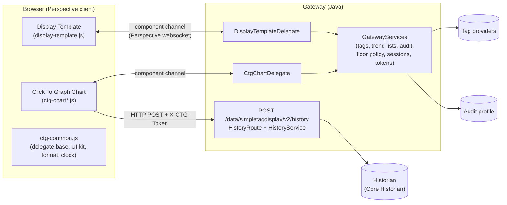
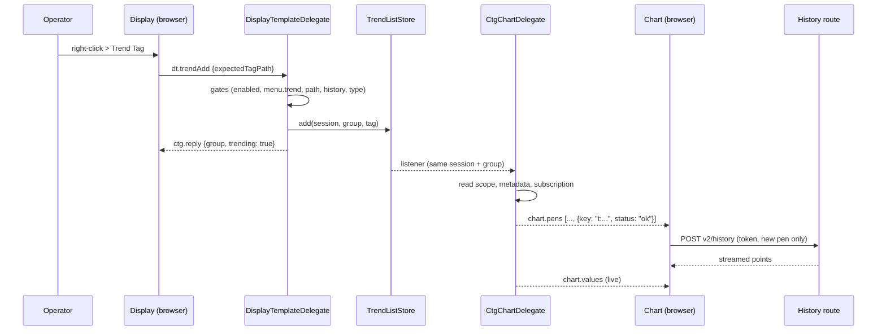
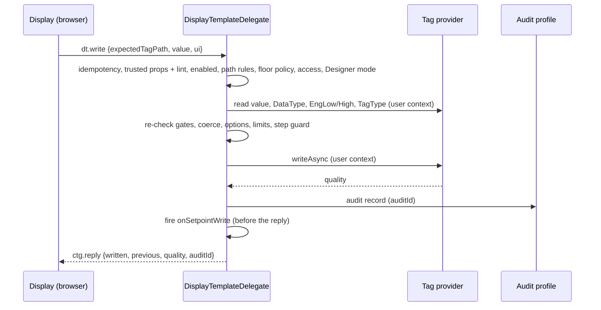

<!-- nav:top -->

[Docs home](../README.md) › [Developer Guide](README.md) › **Architecture**

<!-- /nav:top -->

# 01 — Architecture

How the module is put together. Read this before the Java ([03](03-backend-java.md)) and JavaScript
([04](04-frontend-javascript.md)) deep dives.

**On this page**

- [Scopes and files](#scopes-and-files)
- [The big picture](#the-big-picture)
- [The component channel (delegates)](#the-component-channel-delegates)
- [Message catalogue](#message-catalogue)
- [Sequences](#sequences)
- [The history route](#the-history-route)
- [Trend lists](#trend-lists)
- [Security layers](#security-layers)
- [Versions, caching and upgrades](#versions-caching-and-upgrades)
- [File map](#file-map)

---

## Scopes and files

An Ignition module is a `.modl` (a zip) with jars per scope plus a manifest. This module has three Gradle subprojects:

| Subproject | Scope | Contains |
|---|---|---|
| `common` | gateway + Designer | component descriptors, prop and event JSON schemas, protocol constants (`Protocol`, `ErrorCode`), module constants and the resource version |
| `gateway` | gateway | the gateway hook, the two component **delegates**, every service (tags, history, trend lists, audit, security), the history HTTP route and the browser files under `src/main/resources/mounted/` |
| `designer` | Designer | registers the components in the palette, draws their icons |

The browser code is plain JavaScript (no build step): `ctg-common.js` (shared library), `display-template.js`,
`ctg-chart.js`, `ctg-chart-tools.js`, `ctg-chart-panels.js`, plus the bundled `uplot.min.js`/`uplot.min.css`. The gateway
serves them at `/res/simpletagdisplay/...` and Perspective injects the five module scripts into every page as component
resources.

## The big picture



Two transports:

1. **The component channel.** Each component instance has a gateway-side `ComponentModelDelegate` and a browser-side
   `ComponentStoreDelegate`. They exchange small JSON messages over Perspective's own websocket, inside the user's
   Perspective session. Everything except bulk history uses this channel: values, metadata, alarms, writes,
   configuration edits, trend changes, browse, tokens and annotations.
2. **One HTTP route for history**, `POST /data/simpletagdisplay/v2/history`, because history responses can be megabytes
   and must stream. It is authorised by a short-lived token that the chart delegate issues over the channel.

Version 1.x used eight GET routes with an empty security context; they are deleted.

## The component channel (delegates)

**Envelope.** Browser → gateway messages carry `{v: 2, id, build, ...}`; gateway → browser messages carry
`{v: 2, epoch, seq, serverNow, ...}`. The keys `v`, `id` and `build` are reserved in every body.

- `epoch` is a random id per delegate instance: a new epoch means the gateway delegate restarted (view or project
  change), so the browser discards its state and waits for the snapshot.
- `seq` increases with every push. A gap makes the browser send `ctg.hello {resync: true}` and receive a full snapshot.
- `serverNow` feeds the page-wide gateway clock (median of recent samples), so charts use the gateway's time.

**Requests and replies.** A request carries an `id`; the gateway answers with `ctg.reply {id, ok, data | error}`.
`error` is `{code, message, retryable, details}`; codes are listed in [Troubleshooting](../user-guide/troubleshooting.md#error-codes).
Client timeouts follow the gateway settings: writes and configuration edits `ctg.read.timeoutMs` + `ctg.write.timeoutMs`
+ 5 s (at least 15 s), everything else `ctg.read.timeoutMs` + 3 s (at least 8 s). The delegate remembers the replies to
recent mutating requests by id, so a repeated id is answered from the cache instead of acting twice.

**Rate classes** (token buckets per delegate): `CONTROL` 5/s (burst 10), `READ` 10/s (20), `MUTATE` 2/s (5), `TOKEN` 1/s
(3). Over the limit: `RATE_LIMITED`.

**Handshake.** On mount the browser sends `ctg.hello`; the gateway answers `ctg.welcome` (protocol, build, user, scope,
limits) plus a full snapshot, and only then starts pushing. If the browser's build differs, the welcome says so and the
page shows a non-blocking "module was updated" notice. A protocol mismatch gives `ctg.reload` (blocking "reload the page").

**Liveness.** When a delegate has pushed nothing for `ctg.display.heartbeatMs` (30 s) it sends `ctg.hb`. The page sends
`ctg.ping` every 15 s through one delegate and marks every CTG component stale when no reply comes within 8 s.

**Threads.** Messages arrive on the Perspective session's queue and are never blocked: handlers start asynchronous tag
operations, hop back to the session queue for the reply, and check that the delegate is still running before they touch
it. Tag change callbacks only store the newest value; a module scheduler flushes coalesced pushes. See
[Backend (Java)](03-backend-java.md#threads).

## Message catalogue

| Direction | Message | Purpose |
|---|---|---|
| browser → gateway | `ctg.hello` | handshake / resync |
| browser → gateway | `ctg.ping` | clock sample and page watchdog |
| browser → gateway | `ctg.debug.fire`, `ctg.debug.reloadSettings` | test hooks, only while `ctg.debug` is on |
| gateway → browser | `ctg.welcome`, `ctg.reload`, `ctg.reply`, `ctg.error`, `ctg.hb` | protocol |
| gateway → browser | `dt.snapshot`, `dt.values` | display state (value, quality, meta, alarms, history availability, capabilities, trend state) |
| browser → gateway | `dt.write` | setpoint write `{expectedTagPath, value, ui}` → `{tagPath, written, previous, quality, auditId}` |
| browser → gateway | `dt.configEdit` | units / engineering limits edit → `{tagPath, applied, previous, quality, auditId}` |
| browser → gateway | `dt.trendAdd`, `dt.trendRemove` | Trend Tag / Remove → `{group, trending, count, max}` |
| browser → gateway | `dt.auditQuery` | Change History rows `{t, user, action, value, status, auditId}` |
| gateway → browser | `chart.snapshot`, `chart.pens`, `chart.values` | chart state, effective pen list (`PenInfo` with status), live values by pen key |
| both | `chart.token` | history token `{url, token, expiresAt}` (pushed on rotation; requested on 401) |
| browser → gateway | `chart.trendAdd`, `chart.trendRemove`, `chart.trendClear` | trend list changes from the chart (single or batch add; batch reply lists `added`, `rejected`, `duplicates`) |
| browser → gateway | `chart.browse` | tag browser page `{path, continuation, limit, filterText}` |
| browser → gateway | `chart.browse` + `search` | recursive tag search `{path, search, continuation?, limit}` (first page + `search {complete, stopped, …}`; later pages of the stored matches), `{cancelSearch:true}` (only `true`, alone; anything else is `BAD_REQUEST`) |
| browser → gateway | `chart.annotationSave`, `chart.annotationDelete` | historian annotations (`annotationId`, `type`, `start`, `end`, `text`, `color`) |

`expectedTagPath` protects against a tag path that changed while a dialog was open: the gateway refuses with
`STALE_TARGET` when it no longer matches.

Pen keys: configured pens are `p:<index>`, trend-list pens `t:<normalized path>`. Normalized paths are fully lower-case
and provider-qualified.

## Sequences

**Trend Tag → chart.**



**Setpoint write.**



**Reconnect.** Perspective drops component messages while disconnected. The browser shows the stale look; on reconnect
every delegate sends `ctg.hello {resync: true}` and receives a full snapshot, so no delta is ever needed. After a gateway
restart Perspective reloads the page.

## The history route

`POST /data/simpletagdisplay/v2/history`, JSON in, streamed JSON out. Checks, in order: module running → cross-site /
content type / protocol (`X-CTG-Protocol: 2`) → token (`X-CTG-Token`) and live session → cookie binding (Designer: the
bound address) → `Content-Length` present and within `ctg.history.bodyMaxKb` (411/413 before reading) → bounded,
depth-limited JSON parse → **admission** → read scope per pen → Read permission per pen → plan and execute → stream →
release.

**Admission** keeps one session from starving others: global in-flight requests (`ctg.history.maxInFlightRequests`), a
per-chart bucket (keyed by session and chart, so a renewed token keeps its budget; burst 8, refill every
`ctg.history.minIntervalMs`), per-session concurrency
(`ctg.history.maxConcurrentPerSession`), a plan cost cap (`ctg.history.maxTasksPerRequest`), a global reservation of
points in memory (`ctg.history.maxInFlightPoints`: realistic estimates, a reserve that only light sessions may use, its top
quarter only small ones, and a fair share of the rest per session while sessions contend; see
[the history point budget](../user-guide/gateway-settings.md#the-history-point-budget)), then a **fair executor** that runs sessions
round-robin with per-session queue limits. Refusals are 429/503 with `Retry-After` and `X-CTG-Limit`. Every request has a deadline
(`ctg.history.timeoutMs`); unstarted work is cancelled at the deadline.

**Execution.** Aggregated queries use a bucket width from a fixed ladder; raw queries return on-change samples up to the
point caps. A window that ends in the past gets its last bucket whole once that bucket is complete; at the live edge
the bucket that is still filling is left out. Closed (sealed) time ranges are cached in fixed chunks
(`ctg.history.cacheMb`), but only once the historian has stored a sample at or after the chunk's end (until then Core
Historian may still change the answer). Incremental refreshes send `since` per pen and get only new samples
(aggregated: the buckets of the last 5 s, at least the last two, are replaced via `replaceFrom`, longer than the
historian's storage delay). Requests can also
ask for annotations (`annotations`, or `annotationsOnly` for the 60-s note refresh). Responses are written with a
streaming JSON writer, so a 250 000-point pen never exists as a JSON tree in memory. Non-finite and bad-quality values are
`null`.

## Trend lists

`TrendListStore` holds, per Perspective session and trend group, an ordered list of normalized tag paths (at most
`ctg.trend.maxPens`, at most `ctg.trend.maxGroupsPerSession` groups). Listeners notify every chart delegate of that
session and group, in every tab. Lists are removed when the session ends (`SessionShutdownEvent`, plus a sweep every
`ctg.session.sweepMs` as a safety net for sessions Perspective no longer has; a session that is still open keeps its
lists however long it shows no module component) and cleared when the logged-in user changes
(`ctg.trend.clearOnUserChange`).
`trendGroup` names are normalized the same way on both sides: trimmed, characters outside `[A-Za-z0-9_.-]` become `_`,
at most 64 characters.

## Security layers

1. **User context**: every tag operation runs with the session user's `SecurityContext` (tag permissions apply).
2. **Trusted props**: gateway-side copy of the `[S]` props; browser changes are reverted and logged.
3. **Binding lint**: gates bound to user-influenced sources fail closed.
4. **Floor policy**: administrator minimums (`ctg.write.*`, `ctg.configEdit.*`, `ctg.read.deniedProviders`).
5. **Read scope** for chart runtime pens.
6. **Rate limits and budgets** per delegate, token and session.
7. **Audit** with `auditId` correlation.

Details in [Security and permissions](../user-guide/security-and-permissions.md).

## Versions, caching and upgrades

| Value | Where | Example |
|---|---|---|
| Module version | `simple-tag-display/build.gradle.kts` | `2.0.0` |
| Resource version | computed at build time from the module version and a hash of the browser files | `2.0.0-ecf4cbc1` |
| Protocol version | `SimpleTagDisplayModule.PROTOCOL_VERSION` | `2` |
| Build id | SHA-256 over every jar entry, embedded as `mounted/build-id.txt` | logged at startup: `Display Template / CTG build id <id>` |

Every script URL carries `?v=<resource version>`. The seven versioned files (five module scripts plus uPlot JS/CSS) are
served `immutable` when requested with the running version; everything else, and any other version, is `no-cache`. A new build therefore reaches browsers and the Designer without a
hard refresh, and the module version can stay 2.0.0 between builds. The gateway log shows
`Display Template / CTG 2.0.0-<hash> started (protocol 2)` at startup.

Each script registers its part in `window.__CTG.loaded`; if a page somehow loads two builds, the first one wins and the
console says *reload*.

## File map

```
simple-tag-display/
  common/src/main/java/.../common/
    SimpleTagDisplayModule.java       IDs, versions, BROWSER_RESOURCES
    DisplayTemplateComponent.java     descriptor, events, palette variants
    CtgChartComponent.java            descriptor, events, palette variants
    SchemaLoader.java                 loads the JSON schemas
    protocol/Protocol.java            message names, route, headers
    protocol/ErrorCode.java           error codes (+ HTTP status, retryable, default text)
  common/src/main/resources/schemas/  displaytemplate.props.json, ctgchart.props.json, events/*.json
  designer/src/main/java/.../designer/ SimpleTagDisplayDesignerHook, DisplayTemplateIcon, CtgChartIcon
  gateway/src/main/java/.../gateway/
    SimpleTagDisplayGatewayHook.java  lifecycle, registration, route mount, cache headers
    GatewayServices.java              builds and owns every service
    ModuleSettings.java               ctg.* settings, live reload
    delegate/                         CtgDelegateBase, DisplayTemplateDelegate, CtgChartDelegate, HandlerRegistry, ...
    ops/                              DisplayOps, DisplayGates, ChartOps, DesignPens, AnnotationOps, SettingsFanOut, ...
    security/                         TrustedProps, BindingLint, FloorPolicy, ReadScope, AccessRule, LiveSessions, ...
    tags/                             TagPaths, TagSubscriber, TagMetaReader, WriteCoercer, ValueCodec, TagConfigEditor, ...
    history/                          HistoryRoute, HistoryService, FairHistoryExecutor, HistoryChunkCache, ...
    trend/                            TrendListStore, SessionEvictionSubscriber, ...
    audit/                            CtgAudit, AuditQueryService
    browse/                           TagBrowseService
    annotations/                      AnnotationService
    util/                             Json, RateLimitedLog, TokenBucket, NamedThreadFactory
  gateway/src/main/resources/mounted/ js/*.js, css/uplot.min.css (served at /res/simpletagdisplay/)
  tests/js/                           Node tests;   gateway/src/test/java/  JUnit tests
  tools/                              migrate-v1-views.mjs, gen-prop-docs.mjs
```

<!-- nav:bottom -->

---

← Previous: [Developer Guide](README.md) · [Back to index](README.md) · Next: [JavaScript primer](02-javascript-primer.md) →

<!-- /nav:bottom -->
